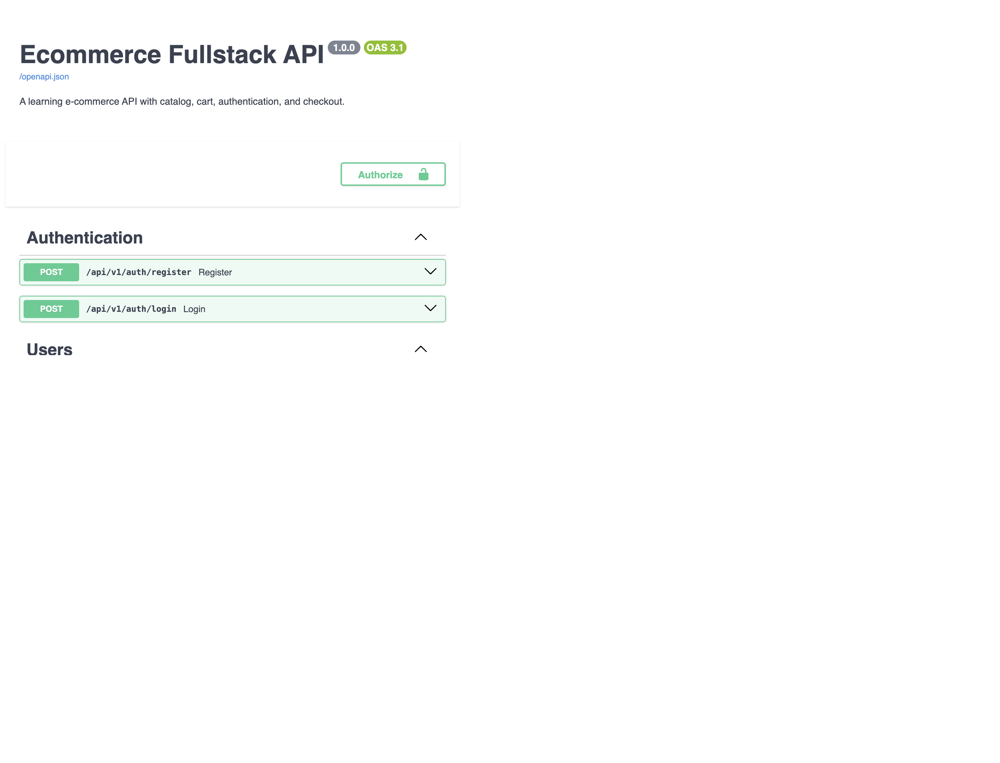
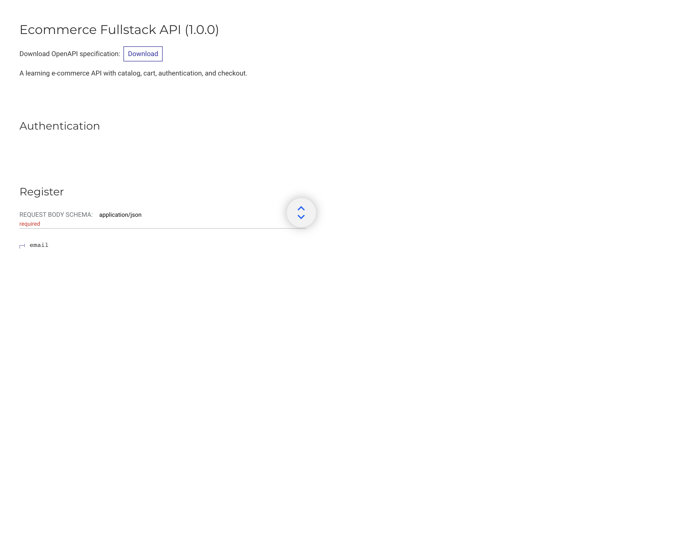
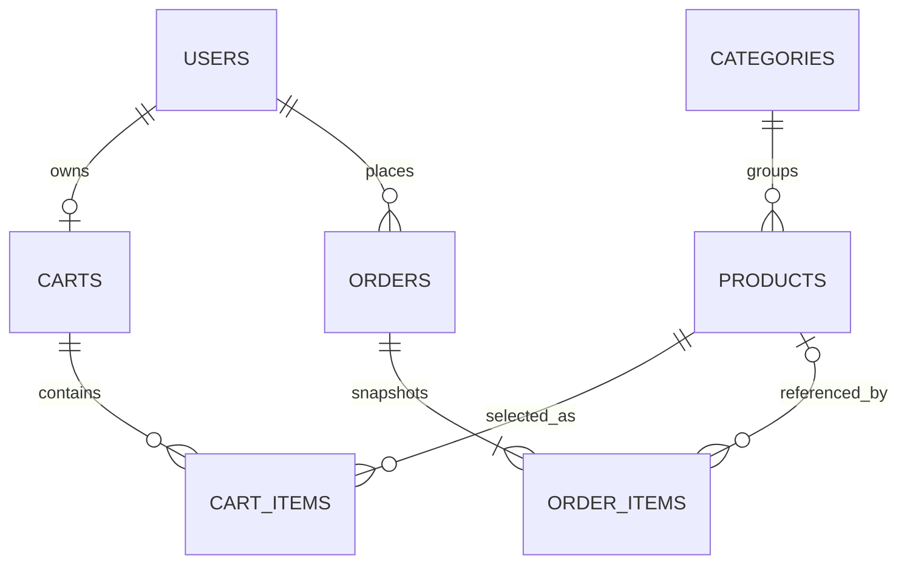
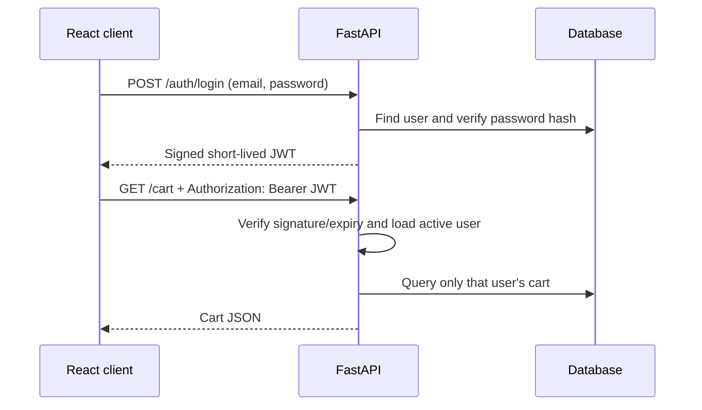
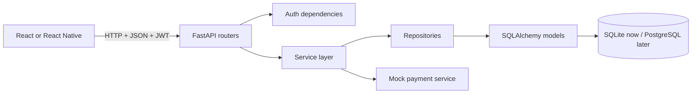

# ecommerce-fullstack

A beginner-friendly REST API built with Python 3.12+, FastAPI, SQLAlchemy, SQLite, Alembic, Pydantic, JWT authentication, and pytest. The code separates HTTP handling, business rules, database queries, and persistence so the project can grow without putting everything in one file.

## Run Locally

From the project root on macOS/Linux:

```bash
python3 --version                 # Python 3.12 or newer
python3 -m venv .venv              # isolate this project's packages
source .venv/bin/activate
cp .env.example .env
pip install -r requirements.txt
alembic upgrade head               # create/update the SQLite tables
uvicorn app.main:app --reload
```

Set a long random `SECRET_KEY` in `.env` before using real accounts. For an admin, also set `ADMIN_EMAIL` and an `ADMIN_PASSWORD` of at least 8 characters, then run `python -m app.create_admin`. This command creates or promotes only the configured account; public registration never accepts a role.

- Swagger UI: http://127.0.0.1:8000/docs
- ReDoc: http://127.0.0.1:8000/redoc
- Health: http://127.0.0.1:8000/health

Use **Try it out** in Swagger. Register, log in, select **Authorize**, enter the access token, and try the protected endpoints. Stop the local server with `Ctrl+C`. `--reload` is for development, not production.

For a step-by-step, beginner-level walkthrough of account registration, login, and using the access token, read [Registration and Login: A Beginner's Guide](docs/registration-and-login-for-beginners.md).

## Screenshots

| Swagger UI | ReDoc |
| --- | --- |
|  |  |

## Project Layout

```text
.
├── alembic/                 # migration environment and generated schema revisions
├── app/
│   ├── api/v1/endpoints/    # HTTP routes, one module per feature
│   ├── core/                # settings, SQLAlchemy Base, engine, DB sessions
│   ├── dependencies/        # authentication and role dependencies
│   ├── models/              # SQLAlchemy tables and relationships
│   ├── repositories/        # reusable database reads
│   ├── schemas/             # Pydantic input/output contracts
│   ├── services/            # business rules and multi-step workflows
│   ├── create_admin.py      # safe initial admin bootstrap
│   └── main.py              # FastAPI app, middleware, error handlers, router
├── tests/                   # isolated SQLite API integration tests
├── .env.example             # local configuration template (copy to .env)
├── alembic.ini              # migration tool configuration
├── requirements.txt         # Python dependencies
├── README.md
```
Tests use FastAPI `TestClient` and a separate in-memory SQLite database. They cover registration/login, permissions, product CRUD/search, cart add/update/remove/clear, totals, checkout, order ownership/history, invalid input, and inventory rollback. These are integration tests because they exercise HTTP routes, validation, services, and a real SQLAlchemy database together. Small unit tests can be added around pure pricing/security functions. Never test against the developer's `ecommerce_fullstack.db`.
`app.main:app` means “import the `app` object from the `app.main` module.” Endpoint functions parse input through Pydantic, call a service, and return a response schema. Services coordinate business rules; repositories hold reusable query logic; SQLAlchemy models map Python classes to tables. `get_db` gives a request its database session. Alembic, rather than application startup code, creates and changes tables.

## Database Design



- `users`: unique email, password hash, role, and active state. A user has zero or one cart and can place many orders.
- `categories`: unique product grouping. A category can contain many products; products require a category.
- `products`: current name, price, category, active state, and inventory. Removing a product is a soft delete so old cart/order references remain meaningful.
- `carts`: one row per user, enforced by a unique foreign key.
- `cart_items`: cart/product link with quantity. The unique `(cart_id, product_id)` constraint prevents duplicate product rows; quantity must be positive.
- `orders`: immutable purchase totals and status. User deletion is deactivation so order history is preserved.
- `order_items`: purchase-time name and unit-price snapshots. A later catalog price/name change cannot rewrite history; a deleted product reference may become null.

Primary keys identify rows. Foreign keys connect rows and stop invalid references. User-to-cart is one-to-one; category-to-product and order-to-item are one-to-many. Cart-to-product is many-to-many through `cart_items`. A SQL join follows these keys, for example joining `orders.user_id` to `users.id` to find an order's owner. The design keeps each fact in one place (normalization): category names live in categories, while order items deliberately duplicate product name/price as historical snapshots. Indexes support common lookups such as email, category, product name/active state, cart owner, and order owner/status. Unique, check, and foreign-key constraints provide a final database-level guard even when application validation is bypassed.

## API Guide

All feature routes are under `/api/v1`. Requests and responses use JSON except `204 No Content` operations. Protected routes require `Authorization: Bearer <access_token>`. Product/category writes, inventory changes, and order status changes require the admin role; profile, cart, checkout, and order history belong to the authenticated user.

| Method and path | Access | Purpose |
| --- | --- | --- |
| `POST /auth/register` | Public | Create customer account |
| `POST /auth/login` | Public | Verify password and issue JWT |
| `GET /users/me` | User | Read own profile |
| `PUT /users/me` | User | Update own name/email |
| `DELETE /users/me` | User | Deactivate account, preserve orders |
| `POST /categories` `GET /categories` | Admin / Public | Create / list categories |
| `GET /categories/{id}` `PUT /categories/{id}` `DELETE /categories/{id}` | Public / Admin | Read / update / delete category |
| `POST /products` `GET /products` | Admin / Public | Create product / list with search, filters, pagination |
| `GET /products/{id}` `PUT /products/{id}` `DELETE /products/{id}` | Public / Admin | Read / update / deactivate product |
| `PATCH /products/{id}/inventory` | Admin | Set inventory quantity |
| `GET /cart` `DELETE /cart` | User | Read cart / clear all items |
| `POST /cart/items` | User | Add product or increase its existing quantity |
| `PATCH /cart/items/{item_id}` `DELETE /cart/items/{item_id}` | User | Update quantity / remove one item |
| `POST /orders/checkout` | User | Validate cart and create an order atomically |
| `GET /orders` `GET /orders/{id}` | User | Read only own order history/details |
| `PATCH /orders/{id}/status` | Admin | Update fulfillment status |

Example registration:

```json
{
  "email": "buyer@example.com",
  "full_name": "Sam Buyer",
  "password": "correct-horse-42"
}
```

Expected response (`201`):

```json
{
  "id": 1,
  "email": "buyer@example.com",
  "full_name": "Sam Buyer",
  "role": "customer",
  "is_active": true,
  "created_at": "2026-11-14T12:00:00"
}
```

Login accepts `{"email":"buyer@example.com","password":"correct-horse-42"}` and returns `{"access_token":"<jwt>","token_type":"bearer"}`. Product creation accepts `name`, `description`, `price`, `inventory`, and `category_id`, for example `{"name":"Notebook","description":"A5","price":"12.50","inventory":20,"category_id":1}`. Cart add accepts `{"product_id":1,"quantity":2}`. Checkout accepts no client-supplied prices; it returns an order with item snapshots, subtotal, tax, shipping, total, and status. Each operation's exact schema, status, and response are visible in `/docs`.

Products support `search`, `category_id`, `min_price`, `max_price`, `limit` (1-100), and `offset`. The response includes `items`, `total`, `limit`, and `offset`. Prices are decimal values, not binary floating-point numbers. The example defaults are 8% tax, $5 shipping below $50, and free shipping at or above $50; change them in `.env` for a real region/business.

## Cart and Checkout Rules

- The cart is looked up by the authenticated user's ID; clients never choose a cart owner.
- Adding a product already in the cart increases its quantity. Quantity must be positive and cannot exceed available inventory.
- Inactive/missing products cannot be added. If a product becomes inactive or stock drops below the cart quantity, the cart marks it unavailable and checkout rejects it.
- Subtotal includes available lines only. Tax and shipping are calculated separately by the backend and returned with the cart.
- Checkout rechecks stock and active status, calculates current prices on the server, creates an order and snapshot items, conditionally decrements inventory, and clears the cart in one database transaction. Any failure rolls all those database writes back.
- Conditional stock updates (`inventory >= requested_quantity`) prevent two checkouts from making stock negative. SQLite is suitable for learning and a small single-process app; PostgreSQL is the next step for higher concurrent writes.

The payment service is deliberately a deterministic mock. Do not treat its `paid` status as real money movement. A Stripe integration would create/confirm a PaymentIntent and handle signed webhooks; avoid holding a database transaction open during network calls. For reliable async payment/order events, add an outbox and background worker.

## Authentication and Errors



Passwords are hashed with Argon2 via `pwdlib`; plaintext is never stored. JWTs contain a user ID and expiry, are signed with `SECRET_KEY`, and are checked by a FastAPI dependency. The dependency reloads the user and role on each request, so changing a role/deactivating an account takes effect without trusting a role supplied by the browser. Do not put secrets in JWT claims or commit `.env`.

Errors use a stable envelope, for example `{"error":{"status":409,"message":"Requested quantity exceeds available inventory"}}`. Validation errors are `422` and include field details. Common statuses: `400` invalid workflow (empty cart), `401` missing/invalid login, `403` wrong role, `404` absent or not-owned resource, `409` duplicate/conflicting inventory/state, `422` malformed/invalid input, and `500` unexpected server failure (details stay in server logs, not the response).

## Frontend Examples

HTTP methods describe actions: `GET` reads, `POST` creates/actions, `PUT` updates profile/product/category, and `PATCH` changes selected fields such as quantity/status. JSON bodies carry input; JSON responses carry data. The bearer header proves the user's identity. Keep the token in an appropriate secure storage mechanism for your platform; never hard-code it or log it.

```javascript
const api = "http://127.0.0.1:8000/api/v1";

async function request(path, { token, ...options } = {}) {
  const response = await fetch(`${api}${path}`, {
    ...options,
    headers: {
      ...(options.body ? { "Content-Type": "application/json" } : {}),
      ...(token ? { Authorization: `Bearer ${token}` } : {}),
      ...options.headers,
    },
  });
  if (!response.ok) throw new Error((await response.json()).error?.message ?? response.statusText);
  return response.status === 204 ? null : response.json();
}

const registered = await request("/auth/register", {
  method: "POST",
  body: JSON.stringify({ email: "buyer@example.com", full_name: "Sam Buyer", password: "correct-horse-42" }),
});
const session = await request("/auth/login", {
  method: "POST",
  body: JSON.stringify({ email: "buyer@example.com", password: "correct-horse-42" }),
});
const token = session.access_token;
const products = await request("/products?search=notebook&limit=10");
const cart = await request("/cart/items", {
  method: "POST", token, body: JSON.stringify({ product_id: products.items[0].id, quantity: 1 }),
});
const updatedCart = await request(`/cart/items/${cart.items[0].id}`, {
  method: "PATCH", token, body: JSON.stringify({ quantity: 2 }),
});
const order = await request("/orders/checkout", { method: "POST", token });
const orders = await request("/orders", { token });
```

React Native uses the same HTTP methods, JSON bodies, and bearer header; use your machine's LAN address instead of `127.0.0.1` when testing from a physical phone. Browser React needs a matching `CORS_ORIGINS` entry; React Native networking is not restricted by browser CORS.

## Tests and Migrations

```bash
pytest -q
alembic revision --autogenerate -m "describe schema change"
alembic upgrade head
alembic check
```

Tests use FastAPI `TestClient` and a separate in-memory SQLite database. They cover registration/login, permissions, product CRUD/search, cart add/update/remove/clear, totals, checkout, order ownership/history, invalid input, and inventory rollback. These are integration tests because they exercise HTTP routes, validation, services, and a real SQLAlchemy database together. Small unit tests can be added around pure pricing/security functions. Never test against the developer's `ecommerce.db`.

## System Design

The current design is a stateless FastAPI service used by React or React Native clients over HTTP and JSON. SQLAlchemy persists application data in SQLite by default, with Alembic managing schema changes. JWTs carry authentication between requests. Payment processing is a deterministic mock, not a real payment integration.

### Architecture



### Request and Transaction Flow

The request lifecycle is client -> Uvicorn/ASGI -> FastAPI route -> validation/auth dependencies -> service -> repository/SQLAlchemy -> database -> Pydantic response -> client. Keep routes thin: HTTP status/parameters belong there, business rules belong in services, and reusable SQL reads belong in repositories. The order service owns checkout's transaction boundary.

Checkout revalidates the cart and current product prices and inventory, creates the order and item snapshots, conditionally decrements stock, and clears the cart in one database transaction. A failure rolls back the database writes, keeping order totals and inventory consistent.

### Scaling Path

This project includes basic pagination, indexes, logging for unexpected failures, and configurable CORS. For a larger deployment, evolve deliberately:

- PostgreSQL adds stronger concurrent-write behavior and production operations; the SQLAlchemy URL changes in configuration rather than application queries.
- Redis can cache public catalog data or hold short-lived rate-limit counters. Cache invalidation and stale-price risk need explicit rules; checkout always re-reads authoritative database prices/stock.
- Add rate limiting at a gateway or Redis-backed middleware, especially around login and registration.
- Send structured logs/metrics/traces to an observability service; redact credentials and personal data.
- Scale API instances horizontally behind a load balancer after keeping them stateless (JWT plus shared database/cache, no in-process session state).
- Put slow email, fulfillment, and webhook work on a background worker with a durable queue. Make jobs idempotent and retry-safe.
- Add payment webhooks, idempotency keys, backups, secrets management, TLS, migrations in deployment, and integration/security checks before production.

The mock payment, local SQLite file, and development secret make this a learning project, not a production-ready store. The architecture leaves clear places to introduce PostgreSQL, Redis, a real payment provider, and workers without moving all code into one module.
