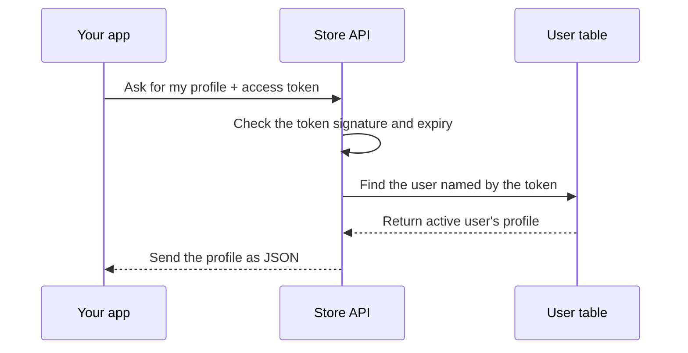

# ecommerce-fullstack: Registration and Login for Beginners

This guide explains how a person makes an account and signs in to this store API. It uses simple words, but the same steps are used in many real websites.

## The Big Idea

Imagine a library. First, you tell the librarian your name and get a library account. Later, you prove that the account is yours. The website works in a similar way:

1. **Register** means “make a new account.”
2. **Log in** means “prove this is my account.”
3. **Access token** means “a temporary pass that says I have logged in.”

The website does not keep your plain password. It keeps a protected password hash instead.

## Start the Website

Open the terminal in the project folder. Run these commands if you have not set up the project yet:

```bash
source .venv/bin/activate
alembic upgrade head
uvicorn app.main:app --reload
```

Open [http://127.0.0.1:8000/docs](http://127.0.0.1:8000/docs). This page is Swagger. It lets you send practice requests to the API. Keep the terminal open while you use the website. Stop the server with `Ctrl+C` when finished.

## Make an Account

In Swagger, find **Authentication**, open `POST /api/v1/auth/register`, and press **Try it out**. Replace the example with:

```json
{
  "email": "sam@example.com",
  "full_name": "Sam Student",
  "password": "my-secret-password"
}
```

Press **Execute**. A successful response has status `201` and looks like this:

```json
{
  "id": 1,
  "email": "sam@example.com",
  "full_name": "Sam Student",
  "role": "customer",
  "is_active": true,
  "created_at": "2026-11-15T12:00:00"
}
```

The time and `id` will be different on your computer. Notice that the response does **not** show the password or its hash.

### What the computer did

1. The browser sent the three pieces of information to `/api/v1/auth/register`.
2. Pydantic checked the information. The email must look like an email, the name cannot be empty, and the password must have at least 8 characters.
3. The app changed the email to lowercase and checked that nobody already uses it.
4. Argon2 turned the password into a one-way hash. A hash is like a scrambled fingerprint: the app can check a password against it later, but it does not save the original password.
5. The database saved the new customer. The app sent back the safe profile.

The signup route is in [`app/api/v1/endpoints/auth.py`](../app/api/v1/endpoints/auth.py). The rules for signup fields are in [`app/schemas/user.py`](../app/schemas/user.py). Saving the user is in [`app/services/user_service.py`](../app/services/user_service.py). The password hash function is in [`app/services/security_service.py`](../app/services/security_service.py), and the user table is in [`app/models/user.py`](../app/models/user.py).

## Log In

In Swagger, open `POST /api/v1/auth/login`, press **Try it out**, and send the same email and password:

```json
{
  "email": "sam@example.com",
  "password": "my-secret-password"
}
```

Press **Execute**. A successful response looks like:

```json
{
  "access_token": "eyJ...long-token-text...",
  "token_type": "bearer"
}
```

Your token will be long. That is normal. Copy the full `access_token` value, but do not share it. It works like a temporary key to your account.

### What the computer did

1. The app looked for the email in the users table.
2. Argon2 checked whether the password matches the saved hash. The app never needs to get the original password back from the hash.
3. If the account is missing, inactive, or the password is wrong, the app returns `401 Unauthorized` with a safe error message.
4. If the check succeeds, the app makes a signed token. The token says which user it belongs to and when it expires. It is signed using the secret key in `.env`.

The login route is in [`app/api/v1/endpoints/auth.py`](../app/api/v1/endpoints/auth.py). The password check is in [`app/services/user_service.py`](../app/services/user_service.py). The token is made in [`app/services/security_service.py`](../app/services/security_service.py).

## Read the `auth.py` Code

Here is the complete authentication endpoint file:

```python
from typing import Annotated

from fastapi import APIRouter, Depends, status
from sqlalchemy.orm import Session

from app.core.database import get_db
from app.schemas.user import LoginRequest, TokenRead, UserCreate, UserRead
from app.services.security_service import create_access_token
from app.services.user_service import authenticate_user, register_user

router = APIRouter(prefix="/auth", tags=["Authentication"])


@router.post("/register", response_model=UserRead, status_code=status.HTTP_201_CREATED)
def register(data: UserCreate, db: Annotated[Session, Depends(get_db)]) -> UserRead:
  return register_user(db, data)


@router.post("/login", response_model=TokenRead)
def login(data: LoginRequest, db: Annotated[Session, Depends(get_db)]) -> TokenRead:
  user = authenticate_user(db, str(data.email), data.password)
  return TokenRead(access_token=create_access_token(user.id))
```

### Imports at the top

- `Annotated` lets us put FastAPI instructions beside a Python type.
- `APIRouter` makes a group of web addresses. This group is for signing up and logging in.
- `Depends` asks FastAPI to provide something needed by a function.
- `status` gives a name to an HTTP number, so we can write `HTTP_201_CREATED` instead of remembering the number `201`.
- `Session` is a connection for talking to the database during one request.
- `get_db` opens that database connection and gives it to a route.
- `LoginRequest` and `UserCreate` describe what information must arrive. `TokenRead` and `UserRead` describe what information may go back.
- `register_user` saves a new account. `authenticate_user` checks the email and password. `create_access_token` makes the temporary login pass.

### Make the route group

```python
router = APIRouter(prefix="/auth", tags=["Authentication"])
```

`prefix="/auth"` means every address in this file starts with `/auth`. Another router adds `/api/v1`, so the signup address becomes `/api/v1/auth/register`. `tags` gives these routes the **Authentication** heading in Swagger.

### The register function

```python
@router.post("/register", response_model=UserRead, status_code=status.HTTP_201_CREATED)
def register(data: UserCreate, db: Annotated[Session, Depends(get_db)]) -> UserRead:
  return register_user(db, data)
```

- `@router.post("/register", ...)` tells FastAPI: “When someone sends a `POST` request to `/auth/register`, run the function below.” `POST` is used because the person is sending information to make something new.
- `response_model=UserRead` tells FastAPI to send back only the safe profile fields. The password and password hash are not part of `UserRead`, so they are not sent back.
- `status_code=status.HTTP_201_CREATED` means “the account was made successfully.”
- `def register(...)` starts a function named `register`.
- `data: UserCreate` means the request data must follow the signup rules, such as a valid email and a password of at least eight characters. FastAPI checks this before running the function.
- `db: Annotated[Session, Depends(get_db)]` means “please give this function a database session.” FastAPI calls `get_db` to get it.
- `-> UserRead` says the function is expected to return a user profile.
- `register_user(db, data)` hands the work to the service. That service checks for an email already in use, hashes the password, and saves the account. This route stays short because the service owns those rules.

### The login function

```python
@router.post("/login", response_model=TokenRead)
def login(data: LoginRequest, db: Annotated[Session, Depends(get_db)]) -> TokenRead:
  user = authenticate_user(db, str(data.email), data.password)
  return TokenRead(access_token=create_access_token(user.id))
```

- `@router.post("/login", ...)` tells FastAPI to run this function for `POST /auth/login`.
- `response_model=TokenRead` says the answer contains an access token and its type.
- `data: LoginRequest` checks that the request has an email and password.
- `db: Annotated[Session, Depends(get_db)]` gives this function a database session, just like it did for registration.
- `authenticate_user(...)` looks up the person and checks the submitted password against the saved password hash. If the check fails, the service stops with an error; no token is made.
- `str(data.email)` turns the checked email into an ordinary Python string for the service.
- `user = ...` keeps the matching user so we can use that user's ID.
- `create_access_token(user.id)` makes a signed pass that identifies the user and has an expiry time. It does not contain the user's password.
- `TokenRead(...)` packs the token into the response shape. FastAPI turns it into JSON for the browser.

So this file is the front desk: it receives the request, asks the right service to do the work, and chooses the safe response. The service files do the careful account and password checks.

## Use Your Login Pass

Some routes are private. For example, `GET /api/v1/users/me` shows the profile of the person who logged in.

In Swagger:

1. Press the **Authorize** button near the top of the page.
2. Paste only the full token text into the box. Do not type the word `Bearer` yourself.
3. Press **Authorize**, then close the box.
4. Open `GET /api/v1/users/me` and press **Try it out**, then **Execute**.

The response should show Sam's profile. Swagger sends a header like this for you:

```http
Authorization: Bearer eyJ...your-token...
```

### How the private route checks the pass



The token is not a password and it does not prove who is holding the computer. It is signed, but its contents are not hidden, so never put a password inside it. Anyone who steals the token could use it until it expires. Keep it private, and log out/delete it from your app when the user signs out. This small project uses a one-hour token by default. A server checks the account is still active each time a protected request arrives.

The token check is in [`app/dependencies/auth.py`](../app/dependencies/auth.py). It reads the token, checks its signature and expiry, then finds the user in the database. A second check in `get_admin_user` makes sure admin-only actions are not available to ordinary customers.

## Try a Wrong Password

Call `POST /api/v1/auth/login` again, but change one letter in the password. The API should return status `401`. It should not tell you whether the email or password was the wrong part; that makes it harder for strangers to guess which emails have accounts.

Try registering `sam@example.com` again. The API should return status `409 Conflict`, because one email can only have one account. Try a password shorter than 8 letters during registration; Pydantic should return `422`, which means the request did not follow the rules.

Errors use a JSON shape like this:

```json
{
  "error": {
    "status": 401,
    "message": "Incorrect email or password",
    "path": "/api/v1/auth/login"
  }
}
```

## Tiny Frontend Example

React or React Native sends the same information as Swagger. This example registers, logs in, then asks for the private profile:

```javascript
const api = "http://127.0.0.1:8000/api/v1";

const signupResponse = await fetch(`${api}/auth/register`, {
  method: "POST",
  headers: { "Content-Type": "application/json" },
  body: JSON.stringify({
    email: "sam@example.com",
    full_name: "Sam Student",
    password: "my-secret-password",
  }),
});
const newUser = await signupResponse.json();

const loginResponse = await fetch(`${api}/auth/login`, {
  method: "POST",
  headers: { "Content-Type": "application/json" },
  body: JSON.stringify({ email: "sam@example.com", password: "my-secret-password" }),
});
const loginResult = await loginResponse.json();
const token = loginResult.access_token;

const profileResponse = await fetch(`${api}/users/me`, {
  headers: { Authorization: `Bearer ${token}` },
});
const myProfile = await profileResponse.json();
```

The signup/login requests use `POST` because they send information to the server. The profile request uses `GET` because it reads information. The token goes in a header, not in the URL. A real app should put the token in secure storage and should not print it to logs. When using a physical phone, replace `127.0.0.1` with your computer's local network address.

## Remember These Three Things

- **Register:** send email, name, and password once to make an account.
- **Log in:** send email and password to receive an access token.
- **Private request:** send the token in the `Authorization: Bearer ...` header.

The server stores a password hash, not the password. Never send real passwords or tokens to anyone, and use a strong private `SECRET_KEY` outside local practice.